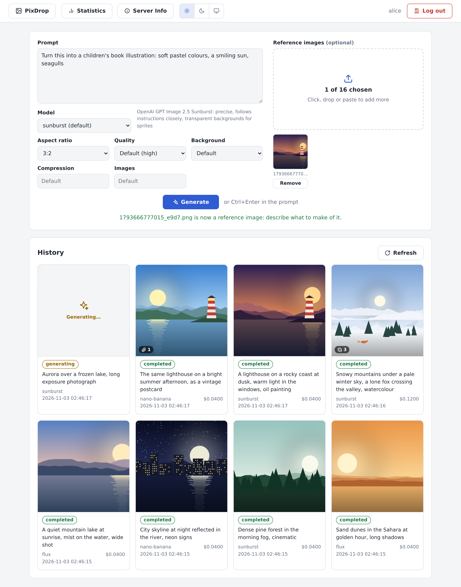

# PixDrop

A small web service that generates images with AI models, for AI agents and for people:
text to image, image to image, and text and image to image, such as game sprites and
assets, icons, or the other sides of a character drawn from one side. It calls
[OpenRouter](https://openrouter.ai) (or any API like it) with the administrator's key, and
gives each user a token, a history and statistics. It is meant to be used by AI agents
through its MCP server and by programs through its HTTP API, and also has a web page.



- **Any image model of OpenRouter.** The administrator names the models users may choose;
  PixDrop reads from OpenRouter's model catalogue what each one accepts, with its own
  values: aspect ratio, resolution or exact size, quality, transparent background, file
  format (SVG for vector models), compression, several images at once, seed, and how many
  reference images. Nothing to look up or keep up to date by hand.
- **Reference images**: up to 16 PNG, JPEG, WebP, GIF or SVG images with the prompt, to
  change an image or to draw new ones in its style.
- **Full and medium size**: every image can be downloaded as generated, or scaled down to
  512 pixels for a quick look.
- **Usage and cost**: the tokens and the cost in US dollars of every job, as the provider
  reports them, and per-user statistics by model and by month. The administrator sees all
  users' with one command.
- **Per-user tokens and storage**, a job list with each job's prompt, options, reference
  images, images and cost. Several generations run at the same time; the web server stays
  responsive meanwhile.
- **Nothing is ever deleted** (see below).
- **MCP server for AI agents** (optional): Claude Code, Codex, Antigravity and other
  agents connect with a token, find PixDrop's tools, and generate images, upload reference
  images and save the results by themselves.

## Running it

```bash
docker build -t pixdrop .

mkdir data
openssl rand -hex 32                         # run once per user to make a token
cat > data/users.json <<'EOF'
{"users": {"alice": "<token for alice>", "bob": "<token for bob>"}}
EOF
cp config.example.json data/config.json      # then put your OpenRouter key in it, and choose the models
sudo chown -R 1001:1001 data                 # the container runs as uid 1001

docker run -d --name pixdrop -p 8000:8000 -v "$PWD/data:/data" \
  -e TZ=Europe/Athens \
  --cap-drop ALL --security-opt no-new-privileges --restart unless-stopped \
  pixdrop
```

or `docker compose up -d` with [`compose.yaml`](compose.yaml). Then open
`http://localhost:8000` and log in with your token.

`data/users.json` has the users, in the same format as
[TeXdrop](https://github.com/nikolaos572/texdrop)'s `config.json` (one file can serve
both). `data/config.json` has the providers, with their keys, and the models: for each one
only the provider, its id at OpenRouter and `"api_type": "images"`, since the options come
from OpenRouter's catalogue. To keep the key out of the file, write
`"api_key_env": "OPENROUTER_API_KEY"` instead of `"api_key"`, and add
`-e OPENROUTER_API_KEY=sk-or-v1-...` to the `docker run` command. To find models,
`docker exec pixdrop python -m pixdrop models` lists OpenRouter's image models, and
`docker exec pixdrop python -m pixdrop models qwen` those matching `qwen` in detail, with a
line to copy into `config.json` (see [CONFIGURATION.md](docs/CONFIGURATION.md)).

Everything the service stores lives in the mounted directory, so the container can be
removed or upgraded without losing data. The service also runs without Docker.

## Using it

**Web page**: write a prompt, choose a model and the options it offers, and add reference
images if you like (drop them on the page, choose them, or paste one); then press
**Generate**. The history below shows each job as it runs and when it is done (point at the
**?** of a failed job to see why it failed); open a job to see its images, download them in
full or medium size, reuse its prompt, or use an image as a reference for the next one.
**Statistics** shows your jobs, images and costs by model and by month, and **Server Info**
the server's settings and limits, the models with their options, and the address for AI
agents when the MCP server is on. The buttons next to them choose a light or dark theme,
or follow the browser's (Auto).

**API**: send the token as `Authorization: Bearer <token>`.

```bash
URL=http://localhost:8000; AUTH="Authorization: Bearer $PIXDROP_TOKEN"
curl -H "$AUTH" -F "prompt=A pixel-art treasure chest, 32x32 sprite" -F background=transparent "$URL/api/jobs?wait=600"
# {"id":"1793635964825_508b","status":"completed",...,"images":[{"index":1,...,"url":"http://localhost:8000/api/jobs/1793635964825_508b/images/1",...}],...}
curl -H "$AUTH" -o chest.png $URL/api/jobs/1793635964825_508b/images/1

# With reference images, and another model than the default
curl -H "$AUTH" -F "prompt=The same knight seen from the back, same style and palette" \
  -F model=nano-banana -F reference=@knight-front.png "$URL/api/jobs?wait=600"
```

`GET /api/models` lists the models and the options each accepts, with its values. The **[API documentation](docs/API.md)**
describes every endpoint with its parameters, responses and errors, how jobs behave, and has
complete examples for building a client.

**AI agents (MCP)**: off by default; add `-e ENABLE_MCP=1` to the `docker run`
command above and PixDrop serves an [MCP](https://modelcontextprotocol.io) server at
`/mcp`. Configure an agent with the server's address and a user's token, and it finds the
tools itself: it picks a model, generates, uploads reference images, follows the job, looks
at the result in medium size, and saves the images where you ask. It needs to run shell
commands (`curl`); images travel through short-lived links that work only from the agent's
address. Connect it once:

```bash
export PIXDROP_TOKEN='<your token>'

# Claude Code, for all projects
claude mcp add --transport http --scope user pixdrop http://localhost:8000/mcp \
  --header "Authorization: Bearer $PIXDROP_TOKEN"

# Codex CLI (it reads PIXDROP_TOKEN when it starts)
codex mcp add pixdrop --url http://localhost:8000/mcp --bearer-token-env-var PIXDROP_TOKEN

# Antigravity (agy)
agy mcp add --header "Authorization: Bearer $PIXDROP_TOKEN" pixdrop http://localhost:8000/mcp
```

Replace `localhost:8000` with the server's address when the agent runs elsewhere. A client
that cannot send headers can use the address `http://localhost:8000/mcp?token=<your token>`
instead.

Then ask, for example:

- *"Use PixDrop to generate a sprite sheet of a knight walking to the right: 4 frames in one
  row, pixel art, transparent background. Save it as `assets/knight-walk.png`."*
- *"Take `assets/knight-front.png` as a reference image and use PixDrop to generate the same
  knight seen from the back, from the left and from the right, in the same style, palette
  and size. Save them next to it as `knight-back.png`, `knight-left.png` and
  `knight-right.png`."*

**[MCP.md](docs/MCP.md)** has the tools, transfer links, reverse proxies and security.

**Nothing is deleted.** PixDrop never deletes a job or an image: there is no delete button,
endpoint or tool. Generated images, reference images and job records stay as the users'
history. (Only waiting has a limit: a job waiting for its reference images fails if they do
not arrive within `LINK_EXPIRY_MINUTES`, and agents' transfer links expire; the jobs stay.)
The administrator can remove old jobs by hand on the server (see
[Cleaning up](docs/DEPLOYMENT.md#cleaning-up)).

## Documentation

- [Deployment](docs/DEPLOYMENT.md): requirements, building, running with or without Docker,
  the data directory and the job records, cleaning up, the statistics of all users, reverse
  proxies, container limits, logs.
- [Configuration](docs/CONFIGURATION.md): the users file, the providers and models, the
  options, the environment variables and their defaults, fixed limits.
- [API documentation](docs/API.md): every endpoint, its parameters, responses and errors,
  how jobs behave, and examples in the shell and Python.
- [MCP server](docs/MCP.md): connecting AI agents (Claude Code, Codex, Antigravity), the
  tools, transfer links, reverse proxies and security.
- [Security](docs/SECURITY.md): the protections, what is not protected, and how to report a
  vulnerability.
- [Development](docs/DEVELOPMENT.md): how it works, running it with a fake provider, and the
  tests.

## License

[MIT](LICENSE)
